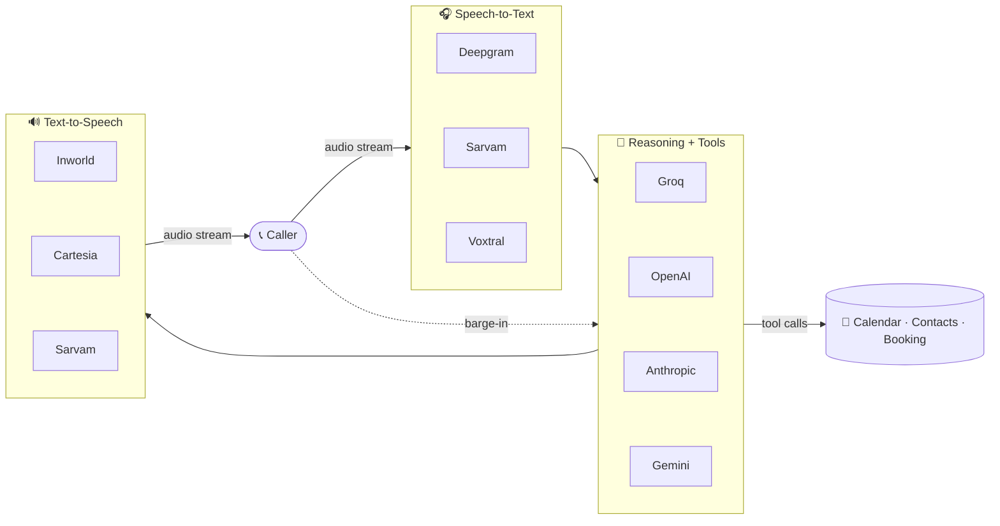

<!-- ═══════════════════════════ HEADER ═══════════════════════════ -->
<p align="center">
  
</p>

<p align="center">
  <a href="https://github.com/Palishiv7">
    
  </a>
</p>

<p align="center">
  
  
  
</p>

<p align="center">
  <a href="https://linkedin.com/in/shivampaliwal"></a>
  <a href="mailto:paliwal.shivam42000@gmail.com"></a>
  <a href="https://play.google.com/store/apps/details?id=com.moneypulse.app"></a>
  <a href="https://moneypulse.vercel.app/"></a>
</p>

<!-- ═══════════════════════════ ABOUT ═══════════════════════════ -->


## 🧠 `whoami`

```yaml
name:      Shivam Paliwal
role:      Backend / AI Systems Engineer
now:       Couchbase  → storage engine platform & developer infrastructure
           ├── LLM-powered code review wired into the review pipeline
           ├── internal MCP server serving engineering context to humans + AI assistants
           └── fault injection & correctness validation for a production storage engine
before:    PhonePe      → concurrent Java services, core backend platform
           Ingram Micro → Python/SQL data pipelines, GCP migration
motto:     "If it hasn't survived a crash test, it isn't done."
```

## ⚡ What I work on

<table>
<tr>
<td width="50%" valign="top">

### 💾 Distributed storage
Crash recovery · persistence · write-ahead logging · fault injection · correctness under failure

</td>
<td width="50%" valign="top">

### 🤖 LLM systems
Real-time voice pipelines · tool-calling agents · multi-model orchestration · MCP servers · automated code review

</td>
</tr>
<tr>
<td width="50%" valign="top">

### ⚙️ Backend services
Concurrent Java & Python systems · REST APIs · sharded data operations at multi-million-user scale

</td>
<td width="50%" valign="top">

### 📊 Data infrastructure
ETL pipelines · columnar processing · BigQuery · GCP

</td>
</tr>
</table>

<!-- ═══════════════════════════ PROJECTS ═══════════════════════════ -->


## 🚀 Selected projects

### 🎙️ VaaniFlow — real-time voice AI platform

> Voice agents for Indian businesses. Callers can interrupt the agent mid-sentence — and it listens.

<p>
  
  
  
</p>



<details>
<summary><b>🔍 Under the hood</b></summary>
<br>

- Streaming **STT → LLM → TTS** pipeline with sub-200ms latency and barge-in detection
- Every provider is swappable from a single config file without touching business logic
- Tool-calling agent autonomously checks availability, books appointments and looks up contacts, syncing to Google Calendar over OAuth2
- Every call is tracked for cost, latency and turn count

</details>

 &nbsp; `WebSockets` `AudioWorklet` `Neon` `JWT`

---

<table>
<tr>
<td width="50%" valign="top">

### 💸 MoneyPulse
**Privacy-first expense tracker** — live on Google Play

Reads bank SMS and categorizes transactions **entirely on-device**.

- 🏦 10+ bank & payment-provider formats
- 🎯 95%+ extraction accuracy on messy templates
- 🔐 Room + SQLCipher, AES-256
- 🚫 No cloud sync, no analytics, no third-party servers

<a href="https://play.google.com/store/apps/details?id=com.moneypulse.app"></a>
<a href="https://moneypulse.vercel.app/"></a>


<br><sub>Jetpack Compose · MVVM · Hilt · Coroutines + Flow</sub>

</td>
<td width="50%" valign="top">

### ⚖️ WaapasLao
**Legal notice generation**

Generates jurisdiction-correct legal demand notices as PDFs.

- 🗺️ State-law data + statutory citations
- 🔤 Devanagari script rendering
- ✅ LLM output passes a quality-control gate before any draft goes out

<br>


<br><sub>Gemini API</sub>

</td>
</tr>
<tr>
<td colspan="2" valign="top">

### 📈 NSE Paper-Trading Simulator
**Fully unattended paper trading over the Nifty 50** — backtesting, intraday and live paper execution against realistic broker cost models.

`🔁 survives reboots` &nbsp; `🕘 decides on its own if the exchange is open` &nbsp; `🩹 repairs ledger state after a crash` &nbsp; `🌙 runs research overnight`

 &nbsp; `pandas` `launchd` &nbsp; <sub>Simulation only — no real capital.</sub>

</td>
</tr>
</table>

<!-- ═══════════════════════════ BUILDING NOW ═══════════════════════════ -->


## 🔒 What I'm building now

<sub>Most of these repos are private, so only live products have links. Happy to demo any of them on request.</sub>

<table>
<tr>
<td colspan="2" valign="top">

### 💸 MoneyPulse · <sub>🟢 LIVE</sub>
**Your Money, Your Rules.** Privacy-first expense tracker for India that works offline: no ads, no logins, no cloud sync. It reads bank SMS **on the device** and sorts every transaction into a category for you.

<a href="https://play.google.com/store/apps/details?id=com.moneypulse.app"></a>
<a href="https://moneypulse.vercel.app/"></a>

`Kotlin` `Jetpack Compose` `SQLCipher` &nbsp; ✅ *shipped & maintained*

</td>
</tr>
<tr>
<td width="50%" valign="top">

### ⚡ Instapply
AI job-application autofill as a browser extension. One click fills forms on ~30 ATS platforms (Workday, Greenhouse, Lever, Ashby…), scores how well you fit the job, and tailors your résumé to each posting.

`JavaScript` `Manifest V3` &nbsp; 🚧 *building*

</td>
<td width="50%" valign="top">

### 📡 SonarAi
Real-time AI assistant app for the desktop.

`TypeScript` &nbsp; 🚧 *building*

</td>
</tr>
<tr>
<td width="50%" valign="top">

### 📈 Chartroom
Local charting workspace built on the open-source Lightweight Charts renderer, with a paper-broker service running in the background. It binds only to localhost, so everything stays on your machine.

`TypeScript` `Vite` `Python` `launchd` &nbsp; 🧪 *personal tool*

</td>
<td width="50%" valign="top">

### 📚 toolbook
Knowledge base for choosing open-source tools: **545 reviewed repos across 39 categories**, each review dated with its evidence. Gives project-aware recommendations and dependency checks for both humans and AI coding agents.

`Python` `Markdown` `YAML` `GitHub Actions` &nbsp; ✅ *active*

</td>
</tr>
<tr>
<td width="50%" valign="top">

### 🧸 KidsPlay Factory
<sub>repo: Automation_kids_store</sub><br>
An autonomous loop for kids' screen-free activity products: demand → decide → create → QA → list → sell → measure → learn → repeat. Runs in supervised mode until it's commercially validated.

`TypeScript` `Node.js` &nbsp; 🚧 *building*

</td>
<td width="50%" valign="top">

### 🎙️ VaaniFlow · ⚖️ WaapasLao
VaaniFlow is the voice-agent platform, and WaapasLao generates legal notices. Both are covered in detail under **Selected projects** above.

`TypeScript` `React` `Gemini` &nbsp; 🧪 *in development*

</td>
</tr>
</table>

<!-- ═══════════════════════════ TOOLS ═══════════════════════════ -->


## 🛠️ Toolbox

<p align="center"><b>Languages</b></p>
<p align="center">
  
</p>

<p align="center"><b>Data & Storage</b></p>
<p align="center">
  
  <br>
  
  
  
</p>

<p align="center"><b>Infra & Tooling</b></p>
<p align="center">
  
  <br>
  
</p>

<p align="center"><b>AI</b></p>
<p align="center">
  
  
  
  
  
  
</p>

<!-- ═══════════════════════════ STATS ═══════════════════════════ -->


## 📊 GitHub pulse

<p align="center">
  
</p>

<p align="center">
  <picture>
    <source media="(prefers-color-scheme: dark)" srcset="https://raw.githubusercontent.com/Palishiv7/Palishiv7/output/github-snake-dark.svg"/>
    <source media="(prefers-color-scheme: light)" srcset="https://raw.githubusercontent.com/Palishiv7/Palishiv7/output/github-snake.svg"/>
    
  </picture>
</p>

> [!NOTE]
> Most of my code lives in private repositories — client work, unreleased projects, and everything at my employer, which runs on Gerrit rather than GitHub. **The public repo list here is thin by design, not by inactivity.**

<!-- ═══════════════════════════ FOOTER ═══════════════════════════ -->
<p align="center">
  <b>Happy to walk through architecture and tradeoffs on any of the above.</b><br><br>
  <a href="https://linkedin.com/in/shivampaliwal"></a>
  <a href="mailto:paliwal.shivam42000@gmail.com"></a>
</p>


